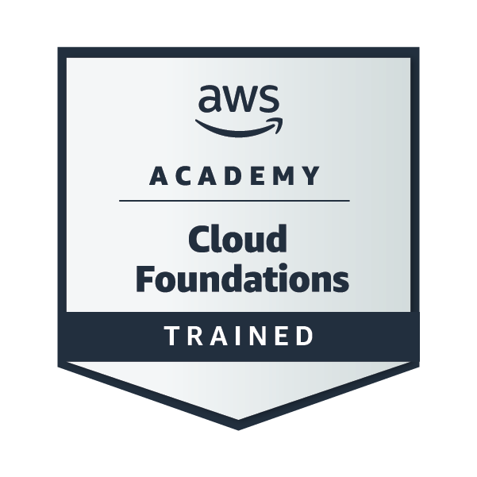

# ¡Marcelo!

## Sobre mí

<ul>
  <li><code><b>Rol:</b> Técnico en Computación (CPU, notebooks, tablets y celulares) y estudiante del <b>último año</b> de la carrera de Desarrollo de Software en el IFTS N.º 29.</code></li>
  <li><code><b>Enfoque Full Stack:</b> Disfruto crear proyectos desde cero y abarcar ambos mundos del desarrollo. Me apasiona construir tanto la arquitectura y lógica del servidor (Back End) como diseñar y maquetar la experiencia interactiva del usuario (Front End).</code></li>
  <li><code><b>Ubicación:</b> Barracas, Buenos Aires, Argentina.</code></li>
  <li><code>📚 <b>Actualmente cursando (Último año del IFTS):</b></code>
    <ul>
      <li><code>Desarrollo de Sistemas Web (Back End) con <b>Node.js</b>.</code></li>
      <li><code>Desarrollo de Sistemas Web (Front End) con <b>React</b>, integración de APIs y testing en React.</code></li>
      <li><code>Ingeniería de Software.</code></li>
      <li><code>Desarrollo e Implementación de Sistemas en la Nube (<b>AWS</b>).</code></li>
    </ul>
  </li>
  <li><code>🚀 <b>Formación adicional:</b></code>
    <ul>
      <li><code>Curso de Frontend con <b>JavaScript</b> (extracurricular, enfocado en fortalecer mis fundamentos de desarrollo web para avanzar con confianza en React. Destaco especialmente la calidad de la enseñanza y el excelente acompañamiento de la profesora durante la cursada.)</code></li>
      <li><code><b>Aguante &lt; Talento Tech /&gt;</b></code></li>
    </ul>
  </li>
</ul>

  <h2 id="habilidades">Habilidades y tecnologías</h2>
  

    
    
    
    
  

  

    
    
    
    
  

  

    
    
    
    
  

  

    
    
    
  

 

  <h2>Insignias y certificaciones</h2>

  

  
<strong>AWS Academy Graduate - Cloud Foundations</strong>

  
Amazon Web Services Training and Certification

